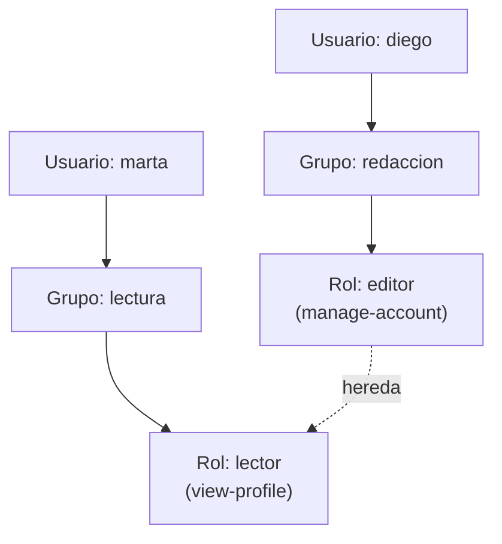

<br/><br/>


# Laboratorio 1: Identidad, realms y control de acceso basado en roles

*Curso de Identidad Digital, Autenticación y Autorización — Módulo 1: Arquitectura de Confianza Cero
y gobierno del ciclo de vida.*

## Objetivos

En las arquitecturas de software modernas, la identidad ha pasado a ser el plano de control
primario: ya no basta con estar "dentro de la red" para tener acceso a nada, sino que cada petición
debe autorizarse en función de quién la realiza y de qué se le permite hacer. Esta práctica
constituye el primer contacto con esa idea de forma tangible. En lugar de estudiar el control de
acceso en abstracto, se levanta un servidor de identidad profesional —**Keycloak**— y se modela
dentro de él una pequeña organización, observando directamente cómo se conceden, se heredan y se
retiran los permisos.

Al finalizar la práctica, el estudiante será capaz de:

- Comprender qué es un *realm* y por qué constituye una frontera de aislamiento entre identidades.
- Diseñar un esquema de control de acceso basado en roles (**RBAC**), incluyendo roles compuestos y
  herencia entre ellos.
- Distinguir la asignación de permisos por usuario de la asignación por grupo, y justificar por qué
  la segunda evita la acumulación descontrolada de privilegios.
- Interpretar el contenido de un *token* de acceso y relacionar lo que este afirma con la
  configuración del servidor.

## Dependencias

Para realizar la práctica, el alumno deberá tener instalado en su ordenador:

- **Docker** y **Docker Compose** ([instalación](https://docs.docker.com/get-docker/)).
- Los puertos **8080** y **9000** libres.

No se requieren conocimientos de programación: en toda la práctica no se escribe una sola línea de
código. El trabajo consiste en configurar el servidor a través de su consola de administración y en
razonar sobre el efecto de cada acción.

## Descripción de la práctica

La práctica simula la gestión de identidades de una pequeña redacción editorial. En esa
organización conviven dos tipos de personas: quienes solo necesitan **consultar** la información y
quienes además deben poder **editarla**. Esta distinción, aparentemente trivial, es el germen de
todo sistema de autorización: hay que decidir quién puede hacer qué, y hay que poder cambiarlo con
rapidez cuando alguien cambia de puesto o abandona la organización.

El servidor que da soporte a este escenario es **Keycloak**, una solución de gestión de identidad y
acceso de código abierto ampliamente utilizada en la industria. Keycloak organiza todo lo que
gestiona dentro de *realms*. Un **realm** es un espacio de identidad completamente independiente:
los usuarios, roles y aplicaciones de un realm no existen en ningún otro. El realm que Keycloak
utiliza para administrarse a sí mismo se llama `master`; para la organización de la práctica se
creará un realm propio, `curso`, de modo que ambos queden aislados.

Dentro del realm se construirá un modelo de **control de acceso basado en roles (RBAC)**. En RBAC
los permisos no se conceden directamente a las personas, sino a **roles** (como `lector` o
`editor`), y las personas obtienen esos permisos al recibir el rol. Para que el modelo sea más
mantenible, los roles se asignarán además a través de **grupos**: un usuario entra en un grupo y
hereda los roles de ese grupo. Finalmente, se establecerá una relación de herencia entre roles —el
rol `editor` será también un `lector`— para no tener que repetir permisos. El modelo completo que se
va a construir es el siguiente:



Como cierre, y en lo que será un hilo conductor de todo el curso, no nos conformaremos con ver que
una pantalla "funciona o no funciona": abriremos el **token** que Keycloak emite para cada usuario y
comprobaremos que lo que el token afirma sobre sus permisos coincide exactamente con lo que se ha
configurado. El token es la evidencia última de que el modelo es correcto.

---

## 1. Puesta en marcha del entorno

El primer paso es levantar el servidor. El fichero `docker-compose.yml` que acompaña a la práctica
arranca Keycloak en modo de desarrollo (`start-dev`), adecuado para aprendizaje pero no para
producción. Para iniciarlo, copie el fichero de configuración y levante el contenedor:

```bash
cp .env.example .env
docker compose up -d
```

El arranque no es instantáneo: Keycloak necesita inicializar su base de datos interna. Espere a que
la columna de estado indique `healthy` antes de continuar:

```bash
docker compose ps
```

Una vez operativo, abra `http://localhost:8080/` y acceda a la **Administration Console** con las
credenciales definidas en `.env` (`admin` / `admin` por defecto). En la esquina superior izquierda
figurará el realm `master`: es el realm de administración del propio Keycloak, y conviene tenerlo
presente porque se retomará al final de la práctica.

> **Pregunta.** Al acceder, Keycloak advierte: "you are logged in as a temporary admin user". ¿Por
> qué califica esa cuenta de *temporary*?
>
> <details><summary>Ver respuesta</summary>
> Porque las credenciales de arranque (las definidas en <code>.env</code>) residen en texto plano, y
> dejar un administrador permanente configurado de ese modo sería un riesgo. Keycloak las marca como
> temporales para forzar su sustitución. Es el principio de Zero Trust aplicado a las propias
> credenciales del sistema: ni siquiera el administrador inicial se considera de confianza indefinida.
> </details>

---

## 2. Modelado de los roles

Con el servidor en marcha, se construye el esqueleto del modelo de acceso. Conviene aquí una
precisión conceptual: Keycloak distingue entre **roles de realm** y **roles de cliente**. Un rol de
realm es un concepto de negocio que define la propia organización (`lector`, `editor`) y no depende
de ninguna aplicación concreta. Un rol de cliente, en cambio, es un permiso que define una
aplicación específica; en esta práctica se usará el cliente interno `account` (el portal de cuenta
del usuario), que ofrece permisos como `view-profile` (ver el perfil) y `manage-account`
(gestionarlo). El modelo consistirá en conectar los roles de negocio con esos permisos concretos.

Realice los siguientes pasos:

1. **Crear el realm:** despliegue `master` (sup. izq.) → **Create realm** → nombre `curso` → Create.
2. **Crear los roles de negocio:** menú **Realm roles** → Create role → `lector` → Save. Repita con
   `editor`.
3. **Vaciar el conjunto de permisos por defecto:** por comodidad, Keycloak concede a todo usuario
   nuevo unos permisos básicos sobre su propia cuenta. Para que en esta práctica *todo* permiso sea
   explícito, se retiran: **Realm settings** → pestaña **User registration** → **Default roles** (con
   "Hide inherited roles" marcado) → seleccione `account / manage-account` **y** `account /
   view-profile` → **Unassign**. A partir de aquí, un usuario sin rol no puede ni ver su perfil.
4. **Definir `lector` como "puede ver":** abra el rol `lector` → pestaña **Associated roles** →
   Assign role → filtre por roles de cliente → `account` → marque `view-profile` → Assign.
5. **Definir `editor` como "lector que además edita":** abra `editor` → **Associated roles** →
   Assign role → busque el rol de **realm** `lector` → Assign; a continuación, Assign role de nuevo,
   esta vez filtrando por cliente `account` → marque `manage-account` → Assign.

El paso 5 es el más interesante del apartado. Un rol que contiene a otros se denomina **rol
compuesto**, y al asociar `editor` con `lector` se está declarando de forma explícita que "todo
editor es también un lector". Esta relación no es un mero atajo: expresa una jerarquía real.

> **Pregunta.** ¿Por qué se asocia `editor` con el rol `lector`, en lugar de añadirle directamente el
> permiso `view-profile` que `lector` ya tiene?
>
> <details><summary>Ver respuesta</summary>
> Porque así la relación "editor ⊇ lector" queda declarada de forma explícita y permanente. Si en el
> futuro cambia el significado de <code>lector</code> (gana o pierde permisos), <code>editor</code>
> hereda ese cambio automáticamente. Duplicar <code>view-profile</code> en ambos roles los haría
> coincidir por casualidad, no por relación: un cambio posterior en uno no se reflejaría en el otro,
> y el modelo se desincronizaría silenciosamente.
> </details>

---

## 3. Usuarios, grupos y herencia de permisos

Definidos los roles, faltan las personas. Aquí se introduce una decisión de diseño fundamental:
**los roles no se asignarán directamente a los usuarios, sino a grupos**, y los usuarios se
incorporarán a esos grupos. La diferencia parece menor con dos usuarios, pero es exactamente la que
previene uno de los problemas clásicos de la gestión de identidad: el *privilege creep*, la
acumulación lenta e invisible de permisos que nadie recuerda haber concedido. Cuando los permisos
viven en los grupos, el acceso de una persona se entiende de un vistazo —por los grupos a los que
pertenece— y se modifica en un solo lugar.

Realice los siguientes pasos:

1. **Crear usuarios:** menú **Users** → Add user → `marta` → Create. Repita con `diego`.
2. **Asignar contraseña:** en cada usuario, pestaña **Credentials** → Set password → **desactive el
   conmutador Temporary** → Save.
3. **Crear grupos:** menú **Groups** → Create group → `lectura` → Create. Repita con `redaccion`.
4. **Asignar el rol a cada grupo:** `lectura` → **Role mapping** → Assign role → `lector` → Assign;
   `redaccion` → **Role mapping** → Assign role → `editor` → Assign.
5. **Incorporar cada usuario a su grupo:** Users → `marta` → **Groups** → Join group → `lectura`;
   Users → `diego` → **Groups** → Join group → `redaccion`.
6. **Verificar la herencia:** Users → `diego` → **Role mapping** → **desactive** "Hide inherited
   roles". Debe figurar `editor`, marcado como heredado de `redaccion`. Repita con `marta`:
   figurará `lector`, heredado de `lectura`. Ninguno de los dos tiene rol asignado de forma directa.

Para comprobar que el modelo tiene consecuencias reales, abra una **ventana privada** y acceda al
portal de cuenta del usuario en `http://localhost:8080/realms/curso/account/`. Inicie sesión como
`diego`, modifique un campo del perfil (por ejemplo, el nombre) y guarde: la operación se completa,
porque `diego` posee `manage-account` a través de su rol `editor`.

> **Advertencia.** No debe repetirse la prueba anterior con Marta. Con únicamente `view-profile` (sin
> `manage-account`), la consola de cuenta de esta versión de Keycloak no se degrada a un modo de solo
> lectura: directamente no carga y muestra una pantalla de error. No se trata de un fallo de
> configuración, sino de una limitación conocida de esta versión. El permiso de Marta se comprobará
> en el apartado siguiente, de una forma más fiable.

> **Pregunta.** ¿Qué ventaja concreta aporta este modelo si `redaccion` tuviera 200 personas en lugar
> de una?
>
> <details><summary>Ver respuesta</summary>
> Que revocar el permiso de edición a las 200 personas es una única acción —retirar el rol del
> grupo— en lugar de 200 modificaciones individuales. Y, a la inversa, dar de alta a alguien consiste
> solo en añadirlo al grupo. La asignación usuario por usuario es precisamente la vía por la que, en
> organizaciones reales, se termina perdiendo el rastro de quién tiene qué.
> </details>

---

## 4. Lectura del token de acceso

Hasta ahora, la autorización se ha comprobado observando si una pantalla permitía o no una acción.
Ese método es frágil y, como se ha visto con Marta, a veces engañoso. El método fiable consiste en
examinar el **token**: cuando un usuario accede a una aplicación, Keycloak emite un token que
contiene, entre otras cosas, la lista de permisos efectivos de ese usuario. Keycloak ofrece una
herramienta para generar ese token sin necesidad de iniciar sesión, lo que permite inspeccionarlo
cómodamente.

1. Menú **Clients** → `account` → pestaña **Client scopes** → sub-pestaña **Evaluate**.
2. Seleccione el usuario `diego` → genere el token → localice en el JSON el campo
   `resource_access.account.roles`: figura **`manage-account`**.
3. Repita con `marta`: en su token, ese mismo campo contiene únicamente **`view-profile`**;
   `manage-account` no aparece.

La diferencia entre ambos usuarios, que la pantalla de Marta no dejaba apreciar, aquí es inequívoca y
está escrita en el propio token. Esta es la idea que se repetirá a lo largo del curso: la verdad
sobre los permisos no está en la interfaz, está en el token.

A continuación, una última observación sobre el aislamiento. Vuelva a la consola de administración,
cambie el desplegable de `curso` a `master` y abra **Users**. Ni Marta ni Diego aparecen.

> **Pregunta.** ¿Por qué un usuario creado en el realm `curso` no existe en el realm `master`?
>
> <details><summary>Ver respuesta</summary>
> Porque un realm es una frontera de aislamiento estricta, no una simple carpeta organizativa. Los
> usuarios, roles y clientes de un realm no son visibles ni utilizables desde ningún otro. Es lo que
> permite que una misma instalación de Keycloak dé servicio a organizaciones distintas sin que se
> mezclen sus identidades.
> </details>

---

## 5. Verificación del modelo: retirar un permiso

Un modelo de acceso no solo debe conceder permisos correctamente, sino también retirarlos con
limpieza. En este apartado se comprueba el efecto en cascada de un cambio hecho sobre el grupo, sin
tocar al usuario.

1. En el realm `curso` → **Groups** → `redaccion` → **Role mapping** → retire (Unassign) el rol
   `editor`. En ningún momento se modifica al usuario Diego.
2. En la pestaña donde Diego mantiene abierta su consola de cuenta, actualice la página. No es
   necesario volver a iniciar sesión: los campos del perfil pasan a solo lectura.
3. Repita la evaluación del apartado 4 para `diego`: `manage-account` ha desaparecido de su token.

El permiso de Diego ha cambiado sin que se le haya tocado a él directamente, y lo ha hecho con solo
actualizar la página. Esto revela algo importante sobre cómo funcionan los tokens.

> **Pregunta.** Diego pierde la capacidad de editar con solo actualizar la página, sin cerrar ni
> volver a abrir sesión. ¿Cómo es posible?
>
> <details><summary>Ver respuesta</summary>
> Porque cada carga de página solicita un token nuevo a partir de la sesión activa, y los permisos se
> recalculan en el momento de emitir cada token. No existe un token "permanente" congelado desde el
> inicio de sesión. Esta característica —que los tokens se renuevan y reflejan el estado actual— es
> clave, y reaparecerá en el Módulo 3 al estudiar su reverso: un token ya emitido no se puede
> "cancelar" a mitad de su vida, hay que esperar a que caduque.
> </details>

---

## Ampliación opcional

Para quien desee profundizar: cree un rol `baja`, asígnele el permiso de cliente `account` →
`delete-account`, vincúlelo a un grupo, incorpore un usuario y verifique la herencia como en los
apartados anteriores. Al acceder a la consola de cuenta de ese usuario, ¿aparece el botón de borrar
la cuenta? Si no es así, ¿a qué se debe, si el rol está correctamente configurado? (Indicación: en
Keycloak, un rol concede un permiso, pero algunas acciones requieren además activar una *required
action* independiente. Rol y *required action* son dos mecanismos distintos que deben coincidir.)

## Entrega

Se exporta el realm construido como evidencia del trabajo:

1. Realm `curso` → **Realm settings** → menú **Action** (sup. der.) → **Partial export**.
2. Marque **Export groups and roles** → Export.
3. Entregue el fichero JSON exportado.

## Resolución de problemas

- No aparecen los usuarios o roles creados → probablemente el desplegable muestra `master` en lugar
  de `curso`. Selecciónelo de nuevo.
- El contenedor tarda en alcanzar el estado `healthy` → es normal en el primer arranque; espere
  30-40 segundos.
- Para reiniciar el entorno desde cero (se elimina el realm, los usuarios y los roles):
  `docker compose down -v && docker compose up -d`.
