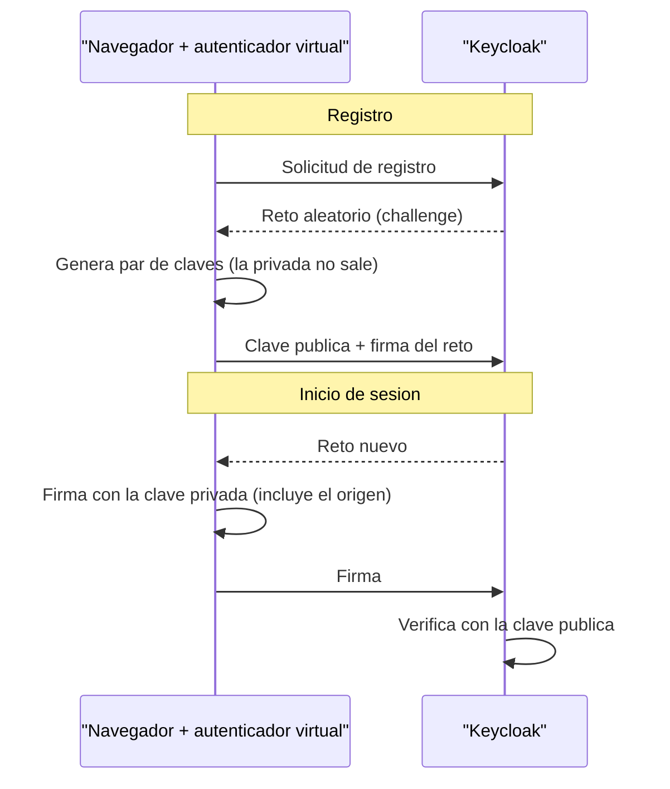

<br/><br/>


# Laboratorio 2: Autenticación sin contraseña con WebAuthn y passkeys

*Curso de Identidad Digital, Autenticación y Autorización — Módulo 2: Autenticación robusta y
criptografía web.*

## Objetivos

Durante décadas, la autenticación ha descansado sobre un secreto compartido: una contraseña que el
usuario conoce y que entrega al servidor para demostrar su identidad. El problema de fondo de ese
modelo es que un secreto que el usuario puede teclear es también un secreto que puede entregar, sin
darse cuenta, a quien no debe —y ni el segundo factor por SMS ni los códigos de un solo uso resuelven
el problema, porque también pueden interceptarse en tiempo real. Esta práctica aborda la alternativa
que la industria ha adoptado para cerrar esa vía: la autenticación criptográfica sin contraseña,
basada en el estándar **WebAuthn**.

Al finalizar la práctica, el estudiante será capaz de:

- Explicar por qué WebAuthn es resistente al *phishing* y qué papel juega el "anclaje al origen".
- Configurar en Keycloak una política de acceso sin contraseña (*passwordless*) basada en passkeys.
- Registrar y utilizar una passkey empleando el autenticador virtual del navegador.
- Distinguir entre passkeys sincronizadas y vinculadas al dispositivo, y razonar sobre la
  recuperación de cuenta.

## Dependencias

- Haber completado el **Laboratorio 1** (deben existir el realm `curso` y el usuario `diego`).
- Un navegador basado en **Chromium** (Chrome o Edge). El autenticador virtual que se usará es una
  herramienta de las DevTools de Chromium y no está disponible en Firefox ni en Safari.

## Descripción de la práctica

Para comprender qué se construye conviene entender primero qué se sustituye. Cuando una persona se
autentica con contraseña, un atacante que logre interponerse —por ejemplo, mediante una página de
*login* falsa que reenvía todo en tiempo real al servidor legítimo— puede capturar tanto la
contraseña como el código de un solo uso y reutilizarlos. El factor adicional no ayuda, porque sigue
siendo un dato que el usuario transmite.

**WebAuthn** elimina esa posibilidad cambiando la naturaleza de la prueba. En el momento del
registro, el dispositivo del usuario (el *autenticador*) genera un par de claves criptográficas: la
clave **privada** se queda dentro del autenticador y no sale jamás; la **pública** se entrega al
servidor. Para iniciar sesión, el servidor envía un reto aleatorio que el autenticador **firma** con
la clave privada, y el servidor verifica esa firma con la pública. Nunca viaja un secreto
reutilizable. Y, de forma crucial, la firma incorpora el **origen** (el dominio) del sitio que la
solicita: una página fraudulenta en `banc0.com` no puede obtener una firma válida para `banco.com`,
porque el origen no coincide. Conviene subrayarlo, porque suele malinterpretarse: la resistencia al
*phishing* no proviene de la biometría —la huella o el rostro solo desbloquean el autenticador
localmente—, sino de ese anclaje criptográfico al origen.

El conjunto de la tecnología, estandarizado por la FIDO Alliance y el W3C, se conoce como **FIDO2** y
se compone de dos piezas: **WebAuthn**, la interfaz del navegador, y **CTAP**, el protocolo entre el
navegador y el autenticador físico. Las credenciales así creadas se denominan coloquialmente
**passkeys**. Los dos flujos que se practicarán —registro e inicio de sesión— son los siguientes:



Queda una dificultad práctica: probar passkeys requiere un autenticador (un sensor de huella, un
chip del dispositivo o una llave física), y no todos los equipos disponen de uno. Para que la
práctica sea reproducible en cualquier ordenador, se utilizará el **autenticador virtual** que
incorporan las DevTools de Chromium, que emula por software un dispositivo FIDO2 real.

---

## 1. Puesta en marcha y autenticador virtual

Este laboratorio reutiliza el mismo Keycloak del Laboratorio 1. Arránquelo:

```bash
cp .env.example .env
docker compose up -d
```

> **Nota.** El `docker-compose.yml` es idéntico al del Laboratorio 1 (mismo nombre de proyecto y
> mismo volumen de datos). Si Keycloak ya estaba en marcha, este comando no crea nada nuevo. Si se
> arranca en un entorno desde cero, el servidor estará vacío y habrá que rehacer el realm y el
> usuario `diego` del Laboratorio 1 antes de continuar.

El orden de los pasos que siguen es importante, porque el autenticador virtual se activa por ventana
del navegador y no de forma global. Realícelos tal cual:

1. Abra **primero** una ventana de incógnito (Ctrl+Shift+N) y confirme que Keycloak responde en
   `http://localhost:8080/realms/curso/account/`.
2. **Dentro de esa misma ventana**, abra las DevTools (F12) → menú **⋮** → **More tools** →
   **WebAuthn**.
3. Marque **Enable virtual authenticator environment**.
4. Cree un autenticador virtual con Protocol `ctap2`, Transport `usb`, y marque **Supports resident
   keys** y **Supports user verification**.

> **Advertencia.** El autenticador virtual es obligatorio: sin él, un equipo sin sensor biométrico ni
> llave física no podría completar la práctica. Y, puesto que se activa por ventana, si las DevTools
> se abren en una ventana distinta de aquella en la que se inicia sesión, esta última no dispondrá del
> entorno y el navegador intentará recurrir a un teléfono móvil mediante código QR. Por eso se abre
> primero la ventana de incógnito y, dentro de ella, las DevTools.

---

## 2. Activación de las passkeys en el realm

Keycloak distingue dos modos de usar WebAuthn, y es importante elegir el correcto. En el modo *como
segundo factor*, la passkey se suma a la contraseña; en el modo *passwordless*, la passkey
**sustituye** a la contraseña como factor único. En esta práctica interesa el segundo.

Acceda a la consola de administración → realm `curso` → **Authentication** → pestaña **Policies** →
**WebAuthn Passwordless Policy** → active **Enabled Passkeys** → establezca **Require Discoverable
Credentials** en **Yes** → Save.

> **Nota.** Al guardar no se apreciará ningún cambio visible en la interfaz. El autenticador virtual
> creado en el apartado anterior ya admite "resident keys", de modo que esta opción resulta aquí
> redundante; se activa igualmente porque es la configuración correcta de cara a un despliegue real.

> **Pregunta.** ¿En qué se diferencia esto del doble factor de autenticación (2FA) tradicional?
>
> <details><summary>Ver respuesta</summary>
> Son dos usos de la misma tecnología. La política "WebAuthn Policy" a secas emplea WebAuthn como
> <em>segundo</em> factor, sumado a la contraseña. La "WebAuthn <strong>Passwordless</strong> Policy",
> la que se ha configurado, emplea WebAuthn <strong>en sustitución</strong> de la contraseña, como
> factor único.
> </details>

> **Pregunta.** ¿Qué resulta más seguro, una passkey sola o una contraseña acompañada de un código
> por SMS (es decir, dos factores)?
>
> <details><summary>Ver respuesta</summary>
> De forma contraintuitiva, la passkey sola suele ser más segura. Lo determinante no es el número de
> factores, sino su resistencia al <em>phishing</em>: un atacante interpuesto en tiempo real puede
> capturar a la vez la contraseña y el código por SMS, pero no una passkey, porque su firma incorpora
> el origen y no es reutilizable en otro sitio. Contar factores es la métrica equivocada.
> </details>

---

## 3. Registro de la passkey

Se registrará una passkey para el usuario `diego`, actuando como lo haría él mismo desde su portal de
cuenta.

1. En la ventana de incógnito, acceda a `http://localhost:8080/realms/curso/account/` e inicie sesión
   con el usuario y la contraseña de Diego (todavía con el método tradicional).
2. Vaya a **Account security** → **Signing in** → localice la opción de passkey o clave de seguridad
   → **Set up passkey**.
3. El navegador lanzará el diálogo de WebAuthn, que el autenticador virtual resolverá automáticamente.
4. Vuelva a la pestaña **WebAuthn** de las DevTools: figurará ahora una credencial, con su
   **Credential ID** y un contador de firmas.

Esa credencial que aparece en el panel es la evidencia visual del concepto central de la práctica.
La clave **privada reside dentro del autenticador** —no en Keycloak, que solo guarda la pública— y
está ligada a este dominio concreto: no serviría en ningún otro sitio.

> **Pregunta.** ¿Qué clave se almacena en el dispositivo del usuario, la pública o la privada?
>
> <details><summary>Ver respuesta</summary>
> La <strong>privada</strong>, que se genera y permanece siempre dentro del autenticador y nunca se
> transmite. La <strong>pública</strong> es la que viaja a Keycloak y se guarda en el servidor. Quien
> posee la pública puede <em>verificar</em> firmas, pero no <em>generarlas</em>: es criptografía
> asimétrica estándar.
> </details>

---

## 4. Inicio de sesión sin contraseña

Comprobado el registro, se verifica que el acceso funciona ya sin contraseña:

1. Cierre la sesión de Diego.
2. Acceda de nuevo a `http://localhost:8080/realms/curso/account/`.
3. La pantalla de inicio de sesión debe ofrecer el acceso con passkey, sin solicitar siquiera el
   nombre de usuario (gracias a la opción "Require Discoverable Credentials"). Al aceptarlo, el acceso
   se completa sin introducir ninguna credencial.

---

## 5. Verificación: eliminar la credencial

Toda credencial puede perderse o comprometerse, y conviene observar qué ocurre entonces. Elimine la
passkey y compruebe el comportamiento:

1. En las DevTools → WebAuthn → elimine la credencial del panel.
2. Cierre la sesión e intente acceder de nuevo mediante la opción de passkey: la operación falla.
3. Acceda ahora como Diego con usuario y contraseña tradicionales: funciona sin problema.

Lo que se ha inutilizado es *un medio* de demostrar la identidad de Diego, no su cuenta ni sus
permisos. El modelo configurado es híbrido: retirar la passkey no deja a nadie fuera mientras la
contraseña siga vigente. Esto conecta con el problema más delicado de la autenticación sin
contraseña, que es la recuperación de cuenta.

> **Pregunta.** ¿Qué ocurre si el usuario pierde el dispositivo que contiene la passkey?
>
> <details><summary>Ver respuesta</summary>
> No existe una solución cómoda: si era su única credencial, pierde el acceso por esa vía, tal como se
> acaba de comprobar. Por eso se distinguen las passkeys <strong>sincronizadas</strong> (iCloud o
> Google, recuperables en otro dispositivo asociado a la misma cuenta) de las <strong>vinculadas al
> dispositivo</strong> (no se copian). Estas últimas, obligatorias en entornos regulados, exigen un
> plan de recuperación específico, como registrar una segunda llave de respaldo.
> </details>

---

## Entrega

Una captura del panel de las DevTools en la que se vea la credencial registrada (con su Credential ID
y su contador), acompañada de una frase breve que explique por qué una passkey no es susceptible de
*phishing*. (Indicación: la clave está en qué incorpora la firma, no en la biometría.)

## Resolución de problemas

- El acceso sin nombre de usuario no funciona → es probable que no se marcara **Supports resident
  keys** al crear el autenticador virtual. Revíselo.
- El navegador ofrece usar el teléfono móvil mediante un código QR → el entorno virtual no está
  activo en esa ventana. Repita el apartado 1 en la misma ventana en la que están abiertas las DevTools.
