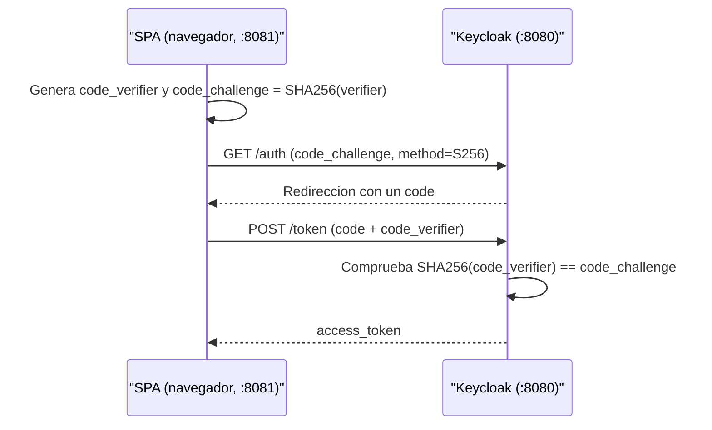
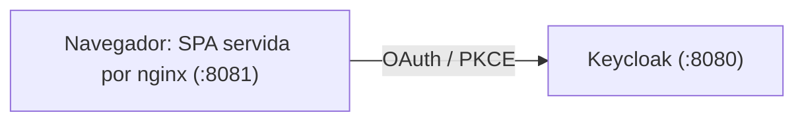

<br/><br/>


# Laboratorio 3.1: Autorización delegada en una SPA con OAuth y PKCE

*Curso de Identidad Digital, Autenticación y Autorización — Módulo 3: Federación, JWT y autenticación
en microservicios.*

## Objetivos

Las aplicaciones web modernas rara vez gestionan ellas mismas las contraseñas de sus usuarios. En su
lugar, delegan la autenticación en un servidor especializado y reciben de él un *token* que acredita
quién es el usuario y qué se le permite hacer. El protocolo que estandariza esa delegación es
**OAuth 2.1**, y su flujo central para aplicaciones que se ejecutan en el navegador se refuerza con
una extensión llamada **PKCE**. Esta práctica consiste en observar ese flujo en funcionamiento, no de
forma teórica, sino inspeccionando con la pestaña de red del navegador cada una de las peticiones que
lo componen.

Al finalizar la práctica, el estudiante será capaz de:

- Describir el flujo *Authorization Code* de OAuth 2.1 y el papel de cada petición.
- Explicar qué problema resuelve PKCE y por qué un código de autorización interceptado resulta inútil
  sin la prueba asociada.
- Registrar un cliente público en Keycloak y configurarlo para exigir PKCE.
- Interpretar un *token* de acceso y los *claims* que lo hacen válido solo para su destinatario.

## Dependencias

- Haber completado el **Laboratorio 1** (realm `curso` y usuario `diego` con contraseña).
- **Conexión a internet**, ya que la aplicación carga una librería desde un CDN.

## Descripción de la práctica

La aplicación de esta práctica es una **SPA** (*Single Page Application*): una página que se ejecuta
íntegramente en el navegador. Su particularidad es que realiza ella misma todo el diálogo con el
servidor de identidad y, por tanto, el token de acceso acaba residiendo en el propio navegador.
Conviene advertirlo desde el principio: **este no es el patrón recomendado para producción**, porque
expone el token a cualquier vulnerabilidad de la página. Se monta así deliberadamente, con fines
didácticos, para ver el mecanismo en su forma más desnuda; el Laboratorio 3.2 presentará la
alternativa correcta.

El protocolo que gobierna el intercambio es **OAuth 2.1**, cuya versión más reciente elimina los
flujos considerados inseguros y exige el uso de **PKCE** (*Proof Key for Code Exchange*). La mecánica
es la siguiente. Antes de empezar, la aplicación genera un valor secreto y aleatorio, el
`code_verifier`, y calcula su "huella" criptográfica, el `code_challenge`, como el resultado de
aplicar SHA-256 al verifier. La aplicación envía al servidor únicamente el *challenge*; el servidor
lo guarda y devuelve un código de autorización (`code`). Para canjear ese código por un token, la
aplicación debe presentar ahora el `code_verifier` original, y el servidor comprueba que su huella
coincide con el *challenge* que guardó. De este modo, aunque un atacante intercepte el `code`, no
podrá canjearlo: le falta el verifier, que nunca viajó por la red hasta el último paso. El flujo
completo es el siguiente:



La infraestructura es mínima: un contenedor sirve la SPA como página estática (mediante `nginx`, sin
compilación ni Node) y el Keycloak de los laboratorios anteriores actúa como servidor de identidad.



---

## 1. Puesta en marcha

Arranque el entorno:

```bash
cp .env.example .env
docker compose up -d
```

A continuación, confirme que ambos servicios responden:

- Keycloak: `http://localhost:8080/realms/curso/account/`.
- La SPA: `http://localhost:8081/`, que debe mostrar el texto "No autenticado." y un botón "Iniciar
  sesión". Si aparece un error de consola relativo a `esm.sh`, revise la conexión a internet.

---

## 2. Registro del cliente público y activación de PKCE

Toda aplicación que quiera delegar la autenticación en Keycloak debe estar registrada en él como
*cliente*. Keycloak distingue dos tipos. Un cliente **confidencial** puede guardar un secreto porque
se ejecuta en un servidor controlado; un cliente **público**, como esta SPA, no puede, porque su
código es visible para cualquiera que abra las DevTools. Precisamente porque no puede guardar un
secreto, el cliente público se protege con PKCE.

1. Consola de administración → realm `curso` → **Clients** → **Create client**.
   - Client ID = `spa-curso` → Next.
   - **Client authentication = OFF** (público), **Standard flow = ON**, el resto OFF → Next.
   - **Valid redirect URIs** = `http://localhost:8081/*`
   - **Valid post logout redirect URIs** = `http://localhost:8081/*`
   - **Web origins** = `http://localhost:8081` → Save.
2. Abra el cliente `spa-curso` → pestaña **Advanced** → **Proof Key for Code Exchange Code Challenge
   Method** → `S256` → Save.

> **Pregunta.** ¿Por qué este cliente se declara **público** y no incorpora un secreto, como sí harán
> otros?
>
> <details><summary>Ver respuesta</summary>
> Porque su código se ejecuta en el navegador del usuario y cualquiera puede leerlo abriendo las
> DevTools. Un secreto ahí no protegería nada, ya que estaría a la vista. Por eso los clientes públicos
> se apoyan en PKCE —una prueba que se genera en cada intento— en lugar de en un secreto fijo.
> </details>

---

## 3. Inicio de sesión con la pestaña de red abierta

El objetivo de este apartado es observar el intercambio paso a paso.

1. Abra `http://localhost:8081/` → DevTools (F12) → pestaña **Network** → marque **Preserve log**.
   Esta última opción es imprescindible: sin ella, las redirecciones del flujo borrarían las
   peticiones anteriores y no se vería la secuencia completa.
2. Pulse **"Iniciar sesión"** y siga, en la pestaña Network, las peticiones que se van produciendo:
   - Una petición **GET** a `.../openid-connect/auth` que incluye los parámetros `code_challenge` y
     `code_challenge_method=S256`. Anote el valor del `code_challenge`: se necesitará en el apartado 4.
   - (Aparecerá también un POST a `.../authenticate`, que corresponde al envío del formulario de
     usuario y contraseña de la propia pantalla de Keycloak; no forma parte del intercambio OAuth y
     puede ignorarse.)
   - Inicie sesión como `diego`.
   - El navegador regresa a la SPA. El `code` llega en el *fragmento* de la URL (la parte tras `#`),
     que por diseño no se envía al servidor; por eso no figura como una petición de red, sino que lo
     lee la propia página mediante JavaScript.
   - Una petición **POST** a `.../openid-connect/token` que lleva en el cuerpo el `code`, el
     `code_verifier` y el `client_id`. Esta es la petición clave del flujo; localícela.
3. La página mostrará el `access_token` en crudo y sus *claims* (`iss`, `aud`, `exp`, entre otros) ya
   interpretados en pantalla.

> **Pregunta.** El token acaba almacenado en una variable JavaScript del navegador. La teoría del
> módulo advierte de que esto es peligroso: ¿por qué exactamente?
>
> <details><summary>Ver respuesta</summary>
> Porque cualquier vulnerabilidad de tipo XSS en la página (una librería de terceros comprometida, un
> fallo de sanitización de entradas) permitiría leer ese token desde el propio JavaScript y
> sustraerlo. Es precisamente la razón de ser del patrón BFF (<em>Backend for Frontend</em>), que se
> pone en práctica en el Laboratorio 3.2.
> </details>

---

## 4. Comprobación criptográfica manual

Este es el único punto de todo el curso en el que se manipula criptografía a mano, y apenas lleva un
par de minutos. Con la petición a `/auth` (que contenía el `code_challenge`) y la petición a `/token`
(que contiene el `code_verifier` en claro) a la vista, calcule la huella SHA-256 del verifier:

```bash
printf '%s' 'EL_CODE_VERIFIER_DE_LA_PETICION' | openssl dgst -binary -sha256 | openssl base64 -A \
  | tr '+/' '-_' | tr -d '='
```

El resultado debe coincidir **exactamente** con el `code_challenge` que viajó en la petición a
`/auth`. Esta comprobación demuestra que el *challenge* no es un valor arbitrario, sino la huella
verificable del verifier: es la prueba de que quien reclama el token es el mismo que inició el
proceso, y nadie más.

---

## 5. Verificación: un código interceptado

Se trata ahora de demostrar, de forma práctica, que un `code` interceptado no sirve de nada sin el
`code_verifier`. Como el código del inicio de sesión legítimo ya se consumió (un `code` solo puede
canjearse una vez), hay que generar uno nuevo y dirigirlo a una página que no lo consuma
automáticamente:

1. Reutilice el `code_challenge` ya calculado.
2. Construya la siguiente URL (sustituyendo `CODE_CHALLENGE` por su valor) y ábrala en el navegador:
   ```
   http://localhost:8080/realms/curso/protocol/openid-connect/auth?client_id=spa-curso&redirect_uri=http://localhost:8081/capturar-code.html&response_type=code&scope=openid&code_challenge=CODE_CHALLENGE&code_challenge_method=S256
   ```
   Como Diego ya tiene una sesión activa, se aterriza directamente en `capturar-code.html` con un
   `code` nuevo en la barra de direcciones.
3. Copie ese `code`.
4. Intente canjearlo **sin** el verifier:
   ```bash
   curl -s -X POST http://localhost:8080/realms/curso/protocol/openid-connect/token \
     -H "Content-Type: application/x-www-form-urlencoded" \
     -d "grant_type=authorization_code" \
     -d "client_id=spa-curso" \
     -d "code=PEGAR_AQUI_EL_CODE" \
     -d "redirect_uri=http://localhost:8081/capturar-code.html"
   ```
   El resultado esperado es un rechazo por parte de Keycloak (`invalid_grant`, por fallo de la
   verificación PKCE).
5. (Opcional) Repita el comando añadiendo `-d "code_verifier=..."` con el valor real calculado antes.
   En este caso el canje sí funciona, lo que confirma que el rechazo anterior se debía exactamente a
   la ausencia del verifier y no a ninguna otra causa.

> **Pregunta.** ¿Por qué fue necesario generar un código nuevo dirigido a `capturar-code.html`, en
> lugar de reutilizar el `code` del inicio de sesión del apartado 3?
>
> <details><summary>Ver respuesta</summary>
> Porque los códigos de autorización son de un solo uso. El del inicio de sesión ya se había canjeado,
> de modo que reutilizarlo habría fallado por estar "ya usado", y no por el motivo que se quiere
> demostrar (la ausencia del verifier). Aislar la causa exacta del rechazo es lo que hace que la
> prueba sea concluyente.
> </details>

---

## Entrega

Una captura de las dos peticiones del inicio de sesión legítimo (`/auth` y `/token`, del apartado 3)
y el *access token* decodificado, con los *claims* `iss`, `aud` y `exp` señalados.

> **Pregunta.** En ese token, ¿qué ocurriría si se intentara emplear contra una aplicación distinta de
> `spa-curso`?
>
> <details><summary>Ver respuesta</summary>
> Sería rechazado en virtud del <em>claim</em> <code>aud</code> (<em>audience</em>): el token solo es
> válido para el cliente al que se emitió. Es el mecanismo que impide que un token sustraído a una
> aplicación sirva para acceder a otra distinta.
> </details>

## Resolución de problemas

- Las peticiones desaparecen de la pestaña Network tras una redirección → no se marcó **Preserve
  log**. Repita el inicio de sesión con la opción activada.
- La petición a `/token` falla con un error de CORS → revise el campo **Web origins** del cliente,
  que debe ser `http://localhost:8081`.
