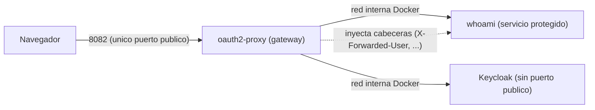

<br/><br/>


# Laboratorio 3.2: Autenticación en el borde con un gateway

*Curso de Identidad Digital, Autenticación y Autorización — Módulo 3: Federación, JWT y autenticación
en microservicios.*

## Objetivos

En el Laboratorio 3.1, la propia aplicación se encargaba del diálogo con el servidor de identidad, y
el token acababa en manos del navegador. Esa disposición, útil para entender el mecanismo, no es la
que se emplea en producción. En una arquitectura de microservicios lo habitual es concentrar la
autenticación en un único punto situado en el **borde** del sistema —un *gateway*—, de modo que los
servicios internos no tengan que saber nada de OAuth ni de tokens. Esta práctica monta esa
disposición y permite comprobar su efecto más característico: un servicio que recibe la identidad del
usuario sin haber implementado una sola línea de autenticación.

Al finalizar la práctica, el estudiante será capaz de:

- Explicar el patrón de autenticación en el borde y qué significa que un servicio "confíe en las
  cabeceras".
- Desplegar un *gateway* (`oauth2-proxy`) que realice el flujo OAuth en nombre de un servicio
  protegido.
- Comprender por qué un servicio interno (Keycloak incluido) puede no necesitar exponer ningún puerto
  al exterior.
- Distinguir entre la validación local de una sesión y la dependencia del proveedor de identidad.

## Dependencias

- Tener disponible el comando `openssl` en la terminal.
- El puerto **8082** libre.
- No se requieren los laboratorios anteriores: esta práctica crea su propio realm desde cero.

## Descripción de la práctica

El escenario se compone de tres piezas. La primera es **`whoami`**, un servicio de demostración cuya
única función es responder a cada petición con un volcado de todas las cabeceras HTTP que ha
recibido; hace las veces del servicio de negocio que se quiere proteger, y es deliberadamente tonto:
no sabe nada de autenticación. La segunda es **Keycloak**, el servidor de identidad. Y la tercera, la
central, es **`oauth2-proxy`**, el *gateway*: un proxy inverso que, antes de dejar pasar una petición
hacia `whoami`, comprueba que exista una sesión válida y, si es así, inyecta en la petición unas
cabeceras con la identidad del usuario.

La decisión de diseño merece una nota. Podría haberse usado un API Gateway completo (del tipo
APISIX), pero su modelo —rutas, *upstreams*, *plugins*, API de administración— supone un coste de
aprendizaje que no compensa para el objetivo de esta práctica. `oauth2-proxy` es una herramienta de
propósito único y configuración plana, mucho más adecuada aquí.

El esquema que se va a desplegar es el siguiente:



Hay un detalle del esquema que conviene asimilar antes de empezar, porque es lo que más desconcierta:
en el `docker-compose.yml`, **el servicio `keycloak` no publica ningún puerto**. Es decir, el
navegador no puede comunicarse con Keycloak directamente; no existe un `localhost:8080` en esta
práctica. El único puerto accesible desde el exterior es el **8082**, el del gateway, y todo el
tráfico —incluido el acceso a la propia consola de administración de Keycloak y a su pantalla de
*login*— pasa a través de él. Esto reproduce fielmente una disposición de producción, en la que el
proveedor de identidad vive en la red interna y no se expone al público.

---

## 1. Puesta en marcha

Copie el fichero de configuración:

```bash
cp .env.example .env
```

El gateway necesita un secreto para firmar sus cookies de sesión. Genérelo y cópielo en `.env`, en la
variable `OAUTH2_PROXY_COOKIE_SECRET`. Debe estar codificado en base64 *URL-safe*, de ahí la
transformación final con `tr`:

```bash
openssl rand -base64 32 | tr '+/' '-_'
```

Levante a continuación todo el conjunto de servicios:

```bash
docker compose up -d
```

Confirme que el arranque ha sido correcto accediendo a `http://localhost:8082/admin/master/console/`,
que debe mostrar la pantalla de inicio de sesión de la consola de Keycloak. Si se produce un *timeout*,
espere a que el servidor complete su arranque (`docker compose ps`, hasta que Keycloak indique
`healthy`; la primera vez puede tardar entre 30 y 40 segundos).

> **Pregunta.** Si Keycloak no publica ningún puerto, ¿cómo consigue el navegador llegar a su pantalla
> de inicio de sesión?
>
> <details><summary>Ver respuesta</summary>
> No llega de forma directa. `oauth2-proxy` tiene registrado a Keycloak como uno de sus
> <em>upstreams</em>, en las rutas <code>/realms</code>, <code>/resources</code> y <code>/admin</code>.
> El navegador siempre se comunica con el gateway —el único puerto existente— y es el gateway quien
> reenvía la petición internamente, por la red de Docker, hasta Keycloak.
> </details>

---

## 2. Configuración de Keycloak a través del gateway

Como la práctica parte de cero, hay que crear el realm, el cliente que representará al gateway y un
usuario de prueba. Todo ello se hace desde la consola de administración, a la que se accede —como
todo— a través del puerto del gateway.

1. **Acceda a la consola:** `http://localhost:8082/admin/master/console/` con las credenciales de
   `.env` (`admin` / `admin`).

   > **Nota.** Esto funciona sin haber configurado todavía nada del gateway porque la ruta
   > `/admin/*` está exenta de requerir sesión del *proxy*. La consola de Keycloak tiene su propio
   > inicio de sesión, independiente del que se va a montar para proteger `whoami`.

2. **Cree el realm:** desplegable `master` → **Create realm** → nombre `curso` → Create.
3. **Cree el cliente confidencial:** realm `curso` → **Clients** → **Create client**.
   - Client ID = `gateway` → Next.
   - **Client authentication = ON** (confidencial, con secreto), **Standard flow = ON**, resto OFF →
     Next.
   - **Valid redirect URIs** = `http://localhost:8082/oauth2/callback` → Save.
4. **Copie el secreto:** pestaña **Credentials** del cliente `gateway` → copie el **Client secret** →
   péguelo en `.env`, en la variable `OAUTH2_PROXY_CLIENT_SECRET` (sustituyendo el valor
   `placeholder-temporal`).
5. **Cree el usuario:** **Users** → Create user → `diego` → Create. Pestaña **Credentials** → Set
   password (con `Temporary = Off`). Pestaña **Details** → active **Email verified** → Save.
6. **Reinicie el gateway** para que incorpore el secreto real:
   ```bash
   docker compose up -d oauth2-proxy
   ```

> **Pregunta.** ¿Por qué este cliente se declara **confidencial**, cuando el del Laboratorio 3.1 era
> público?
>
> <details><summary>Ver respuesta</summary>
> Porque este cliente se ejecuta dentro del contenedor de `oauth2-proxy`, en el lado del servidor,
> donde nadie externo puede leer su configuración. Un secreto en ese contexto sí protege de forma
> efectiva, al contrario de lo que ocurría en la SPA, cuyo código era visible en el navegador.
> </details>

---

## 3. Prueba sin sesión y con sesión

Con todo configurado, se comprueba el comportamiento del gateway ante una petición no autenticada y
ante una autenticada:

1. **Sin sesión:** abra `http://localhost:8082/` en una ventana de incógnito. El gateway responde con
   un **401** o redirige a la pantalla de inicio de sesión de Keycloak.
2. **Con sesión:** complete el inicio de sesión como `diego`. Tras regresar, `whoami` responde con un
   **200** y un volcado de todas las cabeceras HTTP que ha recibido.

---

## 4. Las cabeceras inyectadas

Examine el volcado que ha devuelto `whoami` y localice las siguientes cabeceras, que el usuario no ha
añadido en ningún momento:

- `X-Forwarded-User`
- `X-Forwarded-Email`
- `X-Forwarded-Preferred-Username`
- `Authorization: Bearer ...` (el JWT completo)

Aquí está el núcleo de la práctica. `whoami` desconoce por completo qué es OAuth, qué es un realm o
qué es un token; se limita a recibir unas cabeceras HTTP corrientes, como cualquier servicio. Toda la
complejidad de la autenticación se ha quedado en el borde, en el gateway, y no se ha propagado al
servicio interno. Y todo ello ha sucedido sin que Keycloak haya tenido en ningún momento un puerto
abierto al exterior.

> **Pregunta.** `whoami` recibe la identidad del usuario sin saber nada de OAuth. ¿Qué implicaría esto
> si en lugar de un `whoami` hubiera 50 microservicios distintos?
>
> <details><summary>Ver respuesta</summary>
> Que ninguno de los 50 tendría que implementar el inicio de sesión. Esa es precisamente la razón de
> ser del patrón: centralizar la autenticación en un único punto, el borde, en lugar de repetirla —y
> tener que mantenerla— en cada uno de los servicios.
> </details>

---

## 5. Verificación: manipular lo que el usuario controla

En esta arquitectura el navegador nunca tiene el JWT suelto para manipularlo; lo que posee es una
**cookie de sesión** firmada por el propio `oauth2-proxy`. La verificación actúa, por tanto, sobre esa
cookie y sobre la dependencia del proveedor de identidad.

1. **Manipular la cookie:** DevTools → **Application** → **Cookies** → localice la cookie
   `_oauth2_proxy` → modifique un carácter cualquiera de su valor → recargue `http://localhost:8082/`.
   El sistema vuelve a tratar la petición como si no hubiera sesión. La cookie está protegida
   criptográficamente y no puede falsificarse a mano.
2. **Detener el proveedor de identidad:**
   ```bash
   docker compose stop keycloak
   ```
   Abra una ventana de incógnito nueva y acceda a `http://localhost:8082/`. El gateway redirige al
   inicio de sesión, pero al llegar a `/realms/...` devuelve un **502**: esa ruta la sirve el gateway
   reenviando a Keycloak, que ya no está disponible. Vuelva a arrancarlo a continuación:
   ```bash
   docker compose start keycloak
   ```

> **Pregunta.** Detener Keycloak no afecta a quien ya tenía la sesión iniciada, pero sí impide
> acceder a quien entra de nuevo. ¿A qué se debe esa diferencia?
>
> <details><summary>Ver respuesta</summary>
> A que la cookie ya validada se verifica <strong>localmente</strong> en el gateway (por su firma),
> sin necesidad de consultar a Keycloak en cada petición. Solo se recurre a Keycloak para un inicio de
> sesión nuevo o para renovar un token caducado. Por eso el efecto de detenerlo no se nota de
> inmediato en las sesiones que ya estaban abiertas.
> </details>

---

## Entrega

Las tres respuestas obtenidas (sin sesión, con sesión válida y con la cookie manipulada), junto con la
cabecera inyectada claramente señalada.

## Resolución de problemas

- El inicio de sesión falla con un error de credenciales de cliente → se ha omitido el **paso 6**
  (reiniciar `oauth2-proxy` tras copiar el secreto real), y el gateway sigue usando
  `placeholder-temporal`.
- `oauth2-proxy` no arranca y muestra `cookie_secret must be 16, 24, or 32 bytes` → el secreto de
  cookie se pegó sin aplicar `tr '+/' '-_'` y contenía un `+` o una `/`. Genérelo de nuevo.
- Keycloak parece caído → en el primer arranque tarda entre 30 y 40 segundos en alcanzar el estado
  `healthy`. Espere.
